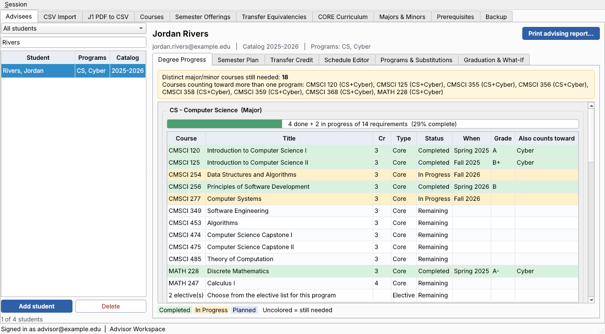
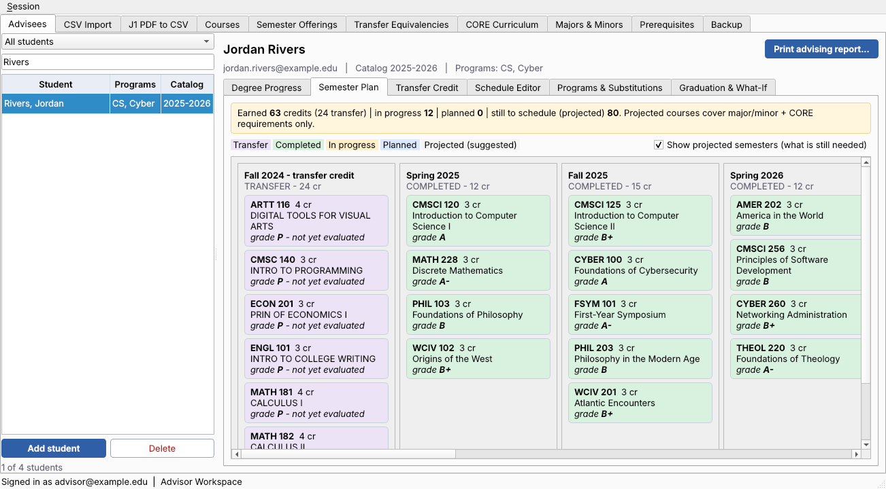
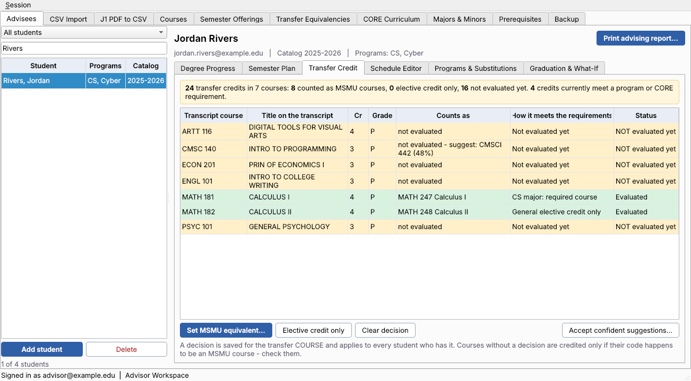
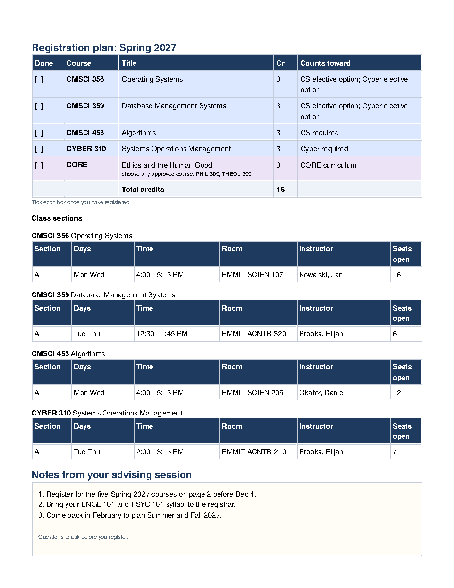

# Undergraduate Degree Tracker

A desktop application for academic advisors (Python, PySide6, MySQL in Docker). In one advising session the advisor imports a
student's transcript, sees progress against every major, minor and the university CORE, evaluates transfer credit, plans the
remaining semesters against the real class schedule, tries what-ifs, and hands the student a **PDF** to register with.

Everything runs locally: no cloud, no internet, no student data leaves the computer. All sample data in this repository is **fictional**.

| | |
|---|---|
|  |  |
|  |  |

## Features
- **Import** a transcript PDF (read locally, checked against the transcript's own totals) or CSV; import a class schedule
- **Degree audit** for majors, minors (any department) and the CORE, with wildcard CORE matching
- **Transfer credit evaluation**: what each course counts as, which requirement it meets, title-based suggestions
- **Semester Plan** view, **graduation projection** and **What-If**
- **Advising report (PDF)**: progress bars, credits chart, registration checklist with real class sections
- **Safety**: numbered migrations, checksummed automatic backups, all-or-nothing restore

## Run it (reviewers: use the executable)
**No Python needed:** open the repository's **Releases** page and download the zip for your system
(`DegreeTracker-Windows.zip`, `DegreeTracker-macOS.zip` or `DegreeTracker-Linux.zip`), unzip it, install and start Docker, then
double-click `Start-DegreeTracker-DEMO.bat` (Windows) or run `./start-degree-tracker.sh --demo` (macOS/Linux).
Sign in as `advisor@example.edu`. See [docs/MENTOR_QUICKSTART.md](docs/MENTOR_QUICKSTART.md).

The executable includes Python and Qt; the database still runs in Docker (MySQL 8), which the start scripts launch for you.
The macOS build is for Apple-silicon Macs.

## Run from source
```bash
docker compose up -d --wait                  # MySQL 8 (data in ./data/mysql)
python -m venv .venv && source .venv/bin/activate      # Windows: .venv\Scripts\activate
pip install -r requirements.txt
python main.py --demo                        # --demo loads fictional students; omit for an empty database
```
Linux may need Qt libraries: `sudo apt install libegl1 libgl1 libxkbcommon-x11-0 libxcb-cursor0 libxcb-xinerama0`.
Keep the project in the Linux home folder when using WSL (not under `/mnt/c`).

## Build the executable
```bash
pip install -r requirements.txt pyinstaller
python -m PyInstaller packaging/degree_tracker.spec --distpath dist --workpath build -y    # for the current operating system
dist/DegreeTracker --selftest --skip-db      # checks the build without opening a window
```
PyInstaller cannot cross-compile, so [.github/workflows/build.yml](.github/workflows/build.yml) builds Windows, macOS and Linux
executables on GitHub for every push. Pushing a tag such as `v1.0.0` also publishes them on the **Releases** page.

## Documentation
- [docs/DEVELOPMENT.md](docs/DEVELOPMENT.md): every file, the MySQL schema, workflows and how the features connect
- [docs/MENTOR_QUICKSTART.md](docs/MENTOR_QUICKSTART.md): a 5-minute tour for reviewers

## Known limits
The per-major requirement lists in `seed_data.py` are a draft to verify with the department. Scanned (image-only) PDFs cannot be
read. The projection covers major, minor and CORE requirements only. Sign-in is by advisor e-mail (no passwords).
