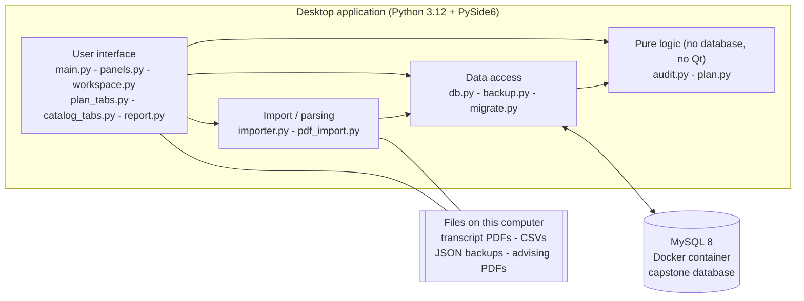
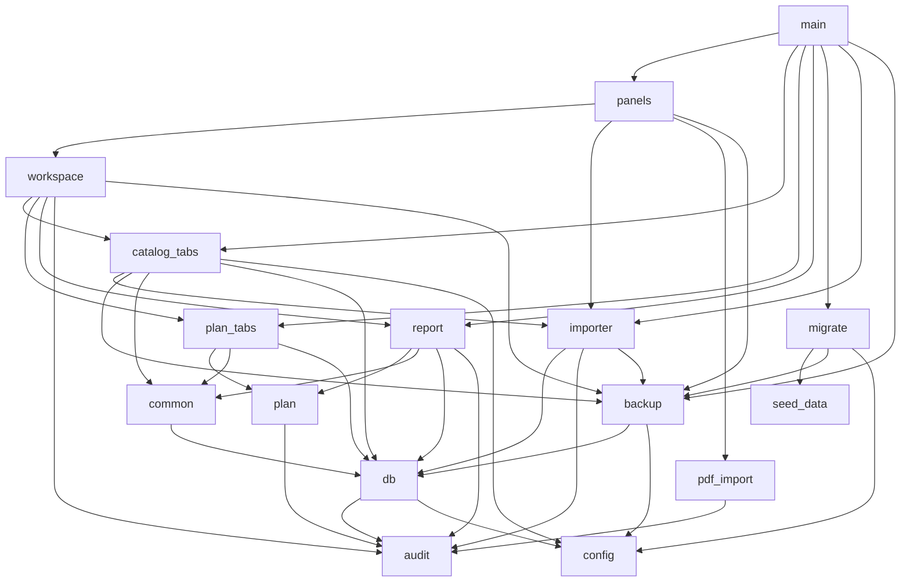
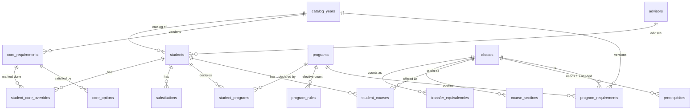
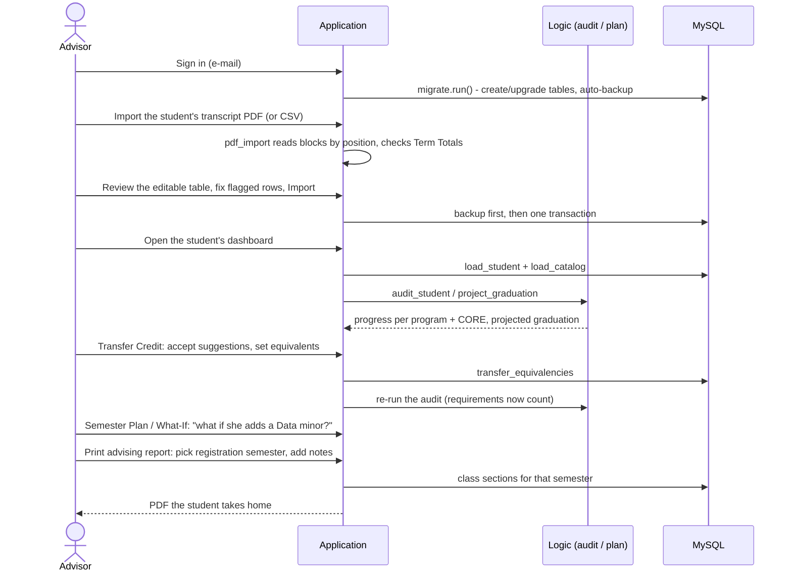
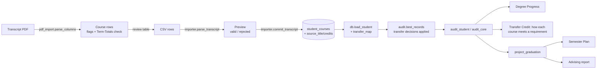

# Development Documentation

**Undergraduate Degree Tracker** - a desktop application that lets an academic advisor run a complete advising session:
import a student's transcript, see exactly where they stand against their majors, minors and the university CORE,
evaluate transfer credit, plan the remaining semesters, and hand the student a PDF to register with.

This document explains **every file in the project (including the MySQL schema), the full workflow, and how the
features depend on one another**. It is written to be read top to bottom once, then used as a reference.

- [1. The idea in one page](#1-the-idea-in-one-page)
- [2. Architecture](#2-architecture)
- [3. Repository map](#3-repository-map)
- [4. The database (MySQL)](#4-the-database-mysql)
- [5. File-by-file reference](#5-file-by-file-reference)
- [6. The advising-session workflow](#6-the-advising-session-workflow)
- [7. How the features connect](#7-how-the-features-connect)
- [8. Data safety and persistence](#8-data-safety-and-persistence)
- [9. Testing](#9-testing)
- [10. Building, packaging and releasing](#10-building-packaging-and-releasing)
- [11. How to extend it](#11-how-to-extend-it)
- [12. Known limits and the roadmap](#12-known-limits-and-the-roadmap)

---

## 1. The idea in one page

An advisor's job in a 30-minute session is to answer four questions: *Where is this student? What counts toward what?
What should they take next? When will they graduate?* Doing that by hand means a transcript, a catalog, a
spreadsheet, and the class schedule. This application puts them in one place and keeps them consistent:

| Advisor question | Feature that answers it | Module(s) |
|---|---|---|
| What has the student taken? | Transcript **PDF/CSV import** | `pdf_import.py`, `importer.py`, `panels.py` |
| Where do they stand per requirement? | **Degree audit** (majors, minors, CORE) | `audit.py`, `workspace.py` |
| What does their transfer credit count as? | **Transfer evaluation** with suggestions | `plan.py`, `plan_tabs.py`, `audit.py` |
| What happened, semester by semester? | **Semester Plan** view | `plan.py`, `plan_tabs.py` |
| What should they take next? | **Projection** + **class schedule** | `audit.py`, `importer.py`, `catalog_tabs.py` |
| What if they add a minor or drop a course? | **What-If** analysis | `audit.py`, `workspace.py` |
| What do they take home? | **Advising report (PDF)** | `report.py` |
| Is the data safe? | **Backups, migrations, safeguards** | `backup.py`, `migrate.py` |

Everything runs on the advisor's own computer: a Python/Qt desktop program talking to a MySQL database in Docker.
No cloud, no internet, no student data leaves the machine.

## 2. Architecture



Three layers, deliberately separated:

1. **Pure logic** (`audit.py`, `plan.py`) never touches the database or the screen. It takes plain Python objects in and
   returns plain objects out. That makes the rules (what counts toward what, when can a student graduate) fast to test
   and impossible to break by a UI change.
2. **Data access** (`db.py`, `migrate.py`, `backup.py`) is the only code that talks to MySQL. Every query is
   parameterised; every multi-step change runs in one transaction.
3. **User interface** (Qt widgets) only displays results and collects decisions.

The application is **flat on purpose**: all modules sit at the repository root and import each other by name
(`import db`). There are no circular imports (checked automatically when the project was reorganised).

### Module dependency graph



## 3. Repository map

```
Computer-Science-Capstone-Project/
|-- README.md                      what it is, how to run it
|-- docker-compose.yml             the MySQL 8 container (data in ./data/mysql)
|-- requirements.txt               runtime packages (PySide6-Essentials, mysql-connector-python, pdfplumber)
|-- .github/workflows/build.yml    CI: builds and self-tests the executable for Windows / macOS / Linux
|-- packaging/                     PyInstaller recipe (degree_tracker.spec) + launcher scripts
|-- main.py                        entry point: sign-in, main window, demo data, start-up, --selftest
|-- config.py                      settings (database, backup folder, paths that also work when packaged)
|-- db.py                          every database query
|-- migrate.py                     creates/upgrades the database safely (5 numbered migrations)
|-- Capstone_Database.sql          the MySQL schema (migration 1)
|-- seed_data.py                   the MSMU catalog, programs, prerequisites and CORE curriculum
|-- seed_demo.py                   command-line shortcut for the fictional demo data
|-- audit.py                       degree audit, CORE matching, projection, What-If   (pure logic)
|-- plan.py                        semester columns, transfer evaluation, suggestions (pure logic)
|-- importer.py                    CSV imports: transcripts, roster, programs, class schedules
|-- pdf_import.py                  transcript PDF -> course rows
|-- backup.py                      JSON backups with checksums, atomic restore
|-- common.py                      shared widgets, colours, error handling
|-- panels.py                      Advisees list, CSV Import tab, PDF import tab
|-- workspace.py                   the per-student dashboard (6 tabs)
|-- plan_tabs.py                   Semester Plan view, Transfer Credit tab, equivalency dialog
|-- catalog_tabs.py                Courses, Semester Offerings, CORE, Majors & Minors, Prerequisites, Backup
|-- report.py                      the advising PDF
|-- img/                           screenshots used by the README
`-- docs/                          this file and the mentor quick-start
```

Total: about 5,800 lines of application code (plus the SQL schema).

## 4. The database (MySQL)

One database, `capstone`, MySQL 8.0, created and upgraded by `migrate.py` (never by hand). 17 tables and 1 view.



### Tables

| Table | What it holds | Written by |
|---|---|---|
| `catalog_years` | Catalog years (2024-2025 ...). A student follows the catalog of the year they entered. | migration 2, Catalog tab |
| `classes` | Every course: code, title, credits, when offered (Fall/Spring/Both/Not Offered), notes. `department` is a *generated* column (the letters of the code) used by the department filters. | seed, imports, Courses tab |
| `programs` | Majors, double majors, minors. `is_custom` marks programs from outside Math & CS (Political Science, Music ...). | seed, Majors & Minors tab, CSV |
| `program_requirements` | Which courses a program requires (`Core`) or offers as electives (`Elective`), per catalog year. | seed, Majors & Minors tab |
| `program_rules` | How many electives a program needs, per catalog year. | seed, Majors & Minors tab |
| `prerequisites` | Course -> prerequisite. `group_no` lets a course say "A *or* B" (same group = alternatives). | seed, Prerequisites tab |
| `core_requirements` | The university CORE slots (First-Year Symposium, Origins of the West, Social Science ...), per catalog year. | migration 3, CORE tab |
| `core_options` | The courses or *patterns* that satisfy a CORE slot. `xx` is a wildcard: `xxMO 300` matches any Modernity course, `GNSCI xxx` any lab science. | migration 3, CORE tab |
| `advisors` | Advisors, who sign in by e-mail (no password, per the project plan). | sign-in dialog |
| `students` | Students: name, e-mail, catalog year, advisor. | Advisees tab, roster CSV |
| `student_programs` | Which programs each student has declared. | Advisees tab, Programs tab |
| `student_courses` | A student's course records: term, year, status (Completed / In Progress / Planned), grade, `is_transfer`, plus what the transcript printed (`source_title`, `source_credits`). One row per student+course+term. | imports, Schedule Editor |
| `student_core_overrides` | An advisor marking a CORE slot satisfied (optionally by a named course) with a note. | Degree Progress tab |
| `substitutions` | "This student's course X counts for requirement Y" (course-level exception). | Programs & Substitutions tab |
| `course_sections` | The class schedule: one row per section meeting (section, lab/lecture/recitation, days, times, room, instructor, seats). Keyed by term+year, so Fall 2025 and Fall 2026 coexist. | CSV Import (schedule), migration 4 |
| `transfer_equivalencies` | Advisor decisions: transfer code -> MSMU course, or `NULL` = "reviewed, elective credit only". Applies to every student with that transfer course. | Transfer Credit tab, migration 5 |
| `schema_migrations` | Which migrations have run (so each runs once). | `migrate.py` |
| *view* `course_overlap` | Courses required by more than one program (used to show "also counts toward"). | schema |

Foreign keys enforce integrity everywhere: deleting a student removes their courses and notes; deleting a course that a
student still has is **refused**; removing a transfer decision never touches student records.

### Migrations (`migrate.py`)

| # | Name | Does |
|---|---|---|
| 1 | base schema | Runs `Capstone_Database.sql` (tables, keys, view). Never executes `DROP`/`TRUNCATE`/`DELETE`. |
| 2 | catalog | Loads catalog years, courses, programs, prerequisites, program requirements from `seed_data.py`. |
| 3 | CORE | Loads the CORE curriculum and its option patterns. |
| 4 | schedule | Adds `course_sections`. |
| 5 | transfer | Adds `student_courses.source_title/source_credits` and `transfer_equivalencies`. |

Each migration runs inside a transaction, is recorded in `schema_migrations`, and runs once. At every start the program
verifies that the tables it needs really exist (`schema_problems()`); if the structure is wrong it says exactly what is
missing and only offers to rebuild when the database holds **zero students**.

## 5. File-by-file reference

### Entry point and settings

**`main.py`** - the application shell. `LoginDialog` / `NewAdvisorDialog` (sign-in by e-mail), `AdvisorWindow`
(the main window with ten tabs and the log-out/quit menu), `seed_demo()` (fictional demo data), `prepare_database()`
(runs migrations, handles the "half-built database" case), `selftest()` and `main()`.
Command line: `--demo` loads fictional students; `--selftest [--skip-db]` verifies an installation without a window;
`--version`. On exit it takes an automatic backup.

**`config.py`** - database host/port/user/password/name, backup folder, the department-name table used by the
filters. Reads environment variables and an optional `degree_tracker.env` file. Knows whether it is running as the
packaged executable (then bundled files live in a temporary folder and backups go to `~/DegreeTracker/backups`).

### Data layer

**`db.py`** - the only module that talks to MySQL (about 60 functions). Connection helpers (`connect`, `query`,
`execute`, `tx` transaction context manager), catalog access (`all_courses`, `load_catalog`), students
(`load_student`, `add_student`, `student_course_rows`, `save_student_course`), programs and requirements,
CORE (`core_rows`, `set_core_override`), the class schedule (`offerings_map`, `offered_courses`, `sections_of`) and
transfer decisions (`transfer_map`, `set_transfer_equivalency`, `msmu_course_candidates`).
`load_catalog` and `load_student` assemble the plain objects the logic layer needs.

**`migrate.py`** - described above. Also `rebuild_unused_legacy()` (refuses if any student exists) and
`split_sql()`, a careful splitter that understands quotes and all three comment styles.

**`Capstone_Database.sql`** - the schema: every statement is `CREATE ... IF NOT EXISTS`, so it can never wipe data.

**`seed_data.py`** - the MSMU catalog written as Python tuples (courses, programs, prerequisites, per-major
requirement lists, the CORE slots and their option patterns). `validate()` fails loudly on a typo (an unknown course
code in a requirement) *before* anything is written. **The per-major requirement lists are a draft to be verified with
the department.**

**`backup.py`** - `make_backup` writes every table to one JSON file with a SHA-256 checksum (atomic rename);
`verify` checks it; `restore` first takes a safety backup, then replaces all data in one transaction with foreign keys
enforced (all-or-nothing). `auto_backup` runs at start-up, before each import, before deleting a student, and on exit;
the last 30 automatic backups are kept. Command line: `python backup.py`, `list`, `restore FILE`.

### Logic layer (no database, no Qt)

**`audit.py`** - the rules engine. Data classes for catalog, student, results; then:
`best_records` (the best status per course, applying transfer decisions), `audit_student` (per-program progress,
"also counts toward", shared courses), `audit_core` (CORE slots matched by code or wildcard pattern, one course per slot,
advisor overrides first), `project_graduation` (a term-by-term plan honouring prerequisites, when courses are offered,
a credit cap, scarcity, and the real class schedule when one is imported), `apply_what_if` / `compare`.

**`plan.py`** - `build_term_columns` (courses grouped by semester, plus projected semesters), `credit_summary`,
`transfer_lines` (for each transfer course: counts-as, which requirement(s) it meets), and `suggest_equivalents`
(title similarity with abbreviation expansion, generic-word discounting, roman-numeral and course-level checks).
Suggestions never apply themselves.

### Import layer

**`importer.py`** - CSV import in four flavours, each `parse_*` (validate, return a `Preview` with valid rows, rejected
rows with line numbers, notes) followed by `commit_*` (one transaction, backup first): `parse_transcript`,
`parse_roster`, `parse_programs`, `parse_offerings`. The schedule importer handles lab/recitation sections, multi-meeting
sections, topic courses and online sections with no times, detects the semester from the start dates, and compares the
schedule with the catalog's own Fall/Spring rules.

**`pdf_import.py`** - transcript PDF to course rows, 100% local (`pdfplumber`). `parse_columns` rebuilds the
multi-line "course blocks" of the MyMount/J1 unofficial transcript from word *positions*, per term table, and
**checks itself against the transcript's own "Term Totals"**. `parse_lines` is the fallback for plain-text layouts.
Scanned (image-only) PDFs are not supported.

### User interface

**`common.py`** - the style sheet, colours, `guard` (turns any exception into a friendly dialog), table helpers,
the searchable course combo box, `NewCourseDialog`.

**`panels.py`** - `StudentsPanel` (searchable advisee list + the workspace), `AddStudentDialog`, `ImportPanel`
(validate -> review -> import for transcripts, roster, programs and class schedules), `PdfPanel` (read a PDF, review
every row in an editable table, save as CSV or import; warns if the name on the PDF is not the selected student).

**`workspace.py`** - the per-student dashboard with six tabs: *Degree Progress* (programs + CORE, progress bars),
*Semester Plan*, *Transfer Credit*, *Schedule Editor*, *Programs & Substitutions*, *Graduation & What-If*, and the
**Print advising report** button.

**`plan_tabs.py`** - `SemesterPlanView` (a column per semester), `TransferPanel` + `EquivalencyDialog` (evaluate each
transfer course), `TransferCatalogTab` (all decisions in one list).

**`catalog_tabs.py`** - catalog management, so the advisor needs no separate admin program: `CoursesTab`,
`OfferingsTab` (browse a semester's schedule by department), `CoreTab`, `ProgramsTab` + `ProgramDialog` (majors and
minors from any department), `PrereqTab`, `BackupTab`.

**`report.py`** - `build_report_html` (tables, progress bars, KPI tiles), `report_images` (the credits-by-semester
chart, drawn with Qt), `save_pdf` (Qt's PDF writer, US Letter, 14 mm margins), `ReportDialog`.

### Support

**`seed_demo.py`** - command-line shortcut for the fictional demo data (`main.seed_demo()`). **`packaging/`** - the
executable recipe and launchers. **`img/`** - screenshots used by the README.

## 6. The advising-session workflow



**Before the semester**: import the registrar's class schedule (*CSV Import -> Semester course offerings*). The program
detects the semester, adds courses it has not seen, and lists where the schedule disagrees with the catalog's rules.
**During the session**: the six steps above. **After**: the PDF is the student's record; the advisor's decisions
(transfer equivalencies, CORE overrides, substitutions, planned courses) are saved and visible next time.

### How a transcript becomes requirement progress



## 7. How the features connect

| If the advisor... | ...then these update automatically |
|---|---|
| Imports a transcript | Degree Progress, Semester Plan, projection, Transfer Credit, report |
| Decides a transfer equivalency | Requirement progress (programs **and** CORE), projection, Semester Plan notes, report |
| Imports a class schedule | Projection for that semester (only courses really offered), Semester Offerings tab, report's section table, catalog courses added |
| Edits CORE / program requirements | Every student's audit and projection |
| Marks a CORE slot satisfied / adds a substitution | That student's audit, projection, report |
| Takes a What-If | Nothing saved; compares projected graduation with and without the change |
| Restores a backup | All tabs refresh (including schedules and transfer decisions) |

The two design choices that make this cohesive: **one source of truth** (the database; the audit is always *recomputed*,
never stored) and **one rules engine** (`audit.py`) used by the dashboard, the transfer evaluation, the projection and
the report alike - so the PDF the student receives can never disagree with what the advisor saw on screen.

## 8. Data safety and persistence

- **Data lives in `./data/mysql`** (a bind mount): `docker compose down` does not delete it. Resetting is a deliberate act.
- **Migrations, not scripts**: the schema is applied once, in transactions, and never with `DROP`.
- **Automatic backups** at start-up, before every import, before deleting a student, before a restore, on exit; each is
  a checksummed JSON file in the backup folder (outside the Docker volume). Restore is all-or-nothing.
- **Refusals**: the program will not rebuild a database that holds students, deletes only with confirmation, rejects a
  transcript whose printed name differs from the selected student (after asking), and imports only validated rows.
- **Privacy**: everything is local. `.gitignore` excludes data, backups and exports. The repository contains **only fictional
  sample data**.

## 9. Testing

> **Not in this repository yet.** The test suite below was written for an earlier layout of the project and has not been
> added here. Until it is, the GitHub build checks that every module compiles and runs `DegreeTracker --selftest --skip-db`
> on each executable.

`python -m pytest tests` (needs MySQL running; tests use a throw-away `capstone_test` database and a temporary backup folder,
so real data is never touched).

| File | Tests | Covers |
|---|---:|---|
| `test_engine.py` | 13 | prerequisites, audit, CORE wildcards, projection, What-If |
| `test_features.py` | 13 | CSV import, outside programs, CORE overrides, substitutions |
| `test_persistence.py` | 11 | seed completeness, backup/restore, tamper detection, migrations |
| `test_legacy_recovery.py` | 7 | half-built database detection, safe rebuild, never-rebuild-with-students |
| `test_pdf_layouts.py` | 6 | six synthetic PDF layouts incl. the two-column landscape bug |
| `test_pdf_mymount.py` | 6 | the MyMount block layout, per-term columns, Term-Totals self-check |
| `test_offerings.py` | 9 | schedule traps (labs, multi-meeting, online), per-semester replace, projection |
| `test_plan_transfer_report.py` | 18 | transfer decisions in the audit, suggestions, semester columns, migration 5, report tables/chart/PDF |
| `test_ui.py`, `test_ui_dialogs.py` | 11 | the windows build and every tab loads (offscreen Qt) |
| `test_startup.py` | 6 | importing the program touches no database, `--selftest`, `--version`, driver flag |
| **Total** | **100** | |

## 10. Building, packaging and releasing

**Run from source**: `docker compose up -d --wait`, `pip install -r requirements.txt`, `python main.py`.

**Executable**: `pip install -r requirements.txt pyinstaller` then
`python -m PyInstaller packaging/degree_tracker.spec --distpath dist --workpath build -y`. PyInstaller
cannot cross-compile, so each operating system builds its own; the GitHub Actions workflow
(`.github/workflows/build.yml`) does this on Windows, macOS and Linux for every push to `main`, runs
`DegreeTracker --selftest --skip-db` on each result, and keeps the zips as run artifacts. Pushing a tag `v*`
(e.g. `git tag v1.0.0 && git push origin v1.0.0`) also attaches the zips to a public GitHub Release.
The executable bundles Python, Qt and the schema file; it still needs **MySQL**, which the launcher scripts start through
Docker (`docker compose up -d --wait`). To use an existing MySQL instead, create `degree_tracker.env` next to the program with `DB_HOST=...`.

## 11. How to extend it

| To add... | Touch |
|---|---|
| a new column / table | a new numbered function in `migrate.py` (`_m6_...`) appended to `MIGRATIONS`; never edit an old one |
| a new requirement rule | `audit.py` (pure; add a test in `tests/test_engine.py`) |
| a new import format | `importer.py` (`parse_x` / `commit_x`) + a `KINDS` entry in `ImportPanel` |
| a new dashboard tab | a widget in `plan_tabs.py` or `workspace.py`, built in `StudentWorkspace.__init__`, filled in `recompute()` |
| a new report section | `build_report_html` in `report.py` (+ a checkbox in `ReportDialog`) |
| new catalog data | `seed_data.py` for fresh installs, or the Catalog tabs for a running one |

## 12. Known limits and the roadmap

**Limits**: the per-major requirement lists in `seed_data.py` are a draft to verify with the department; scanned PDFs
cannot be read; transfer decisions are per transfer course *code* (two colleges using the same code for different courses
would share a decision); the graduation projection covers major, minor and CORE requirements only (not free electives or
the 120-credit total); no passwords (per the project plan, sign-in is by advisor e-mail).

**Roadmap** (also in the presentation): a read-only student view or e-mailed PDF; role-based sign-in with an audit log;
direct J1 integration instead of PDFs; OCR for scanned transcripts; schedule-conflict checking in the registration plan;
cohort analytics (demand for each course next term from students' plans); a standalone mode that needs no Docker.
